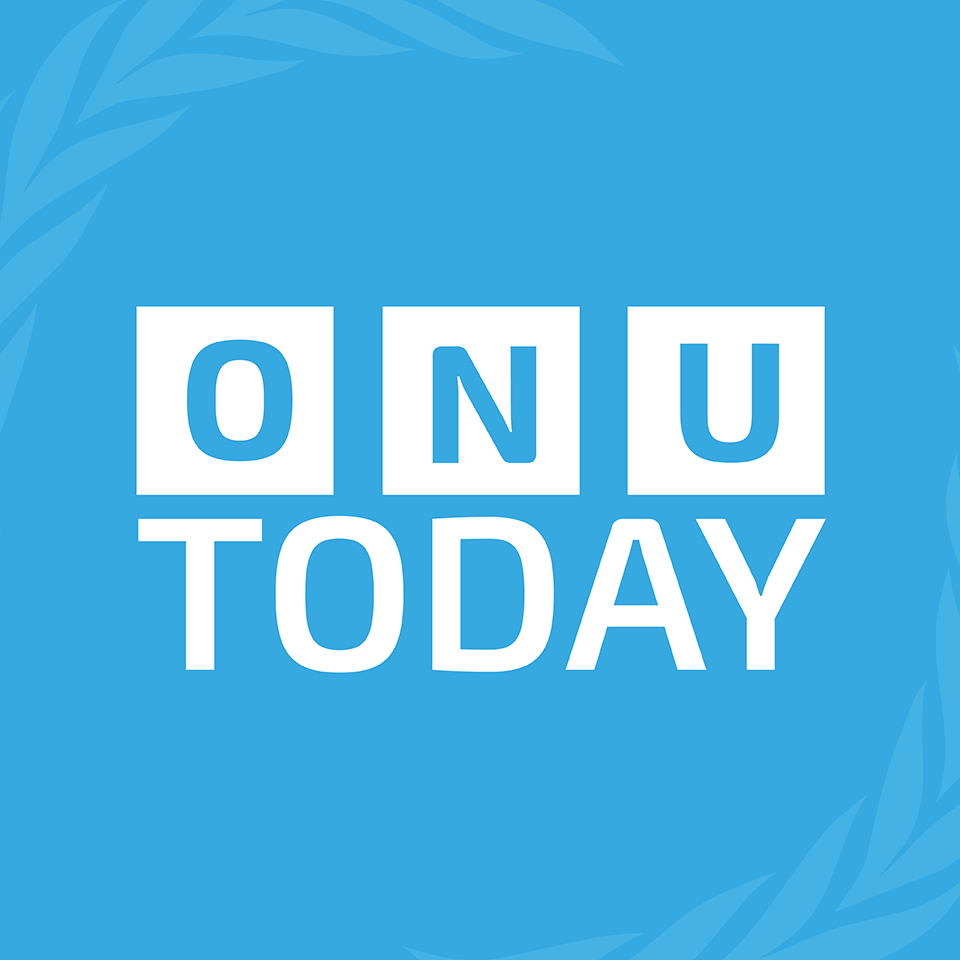
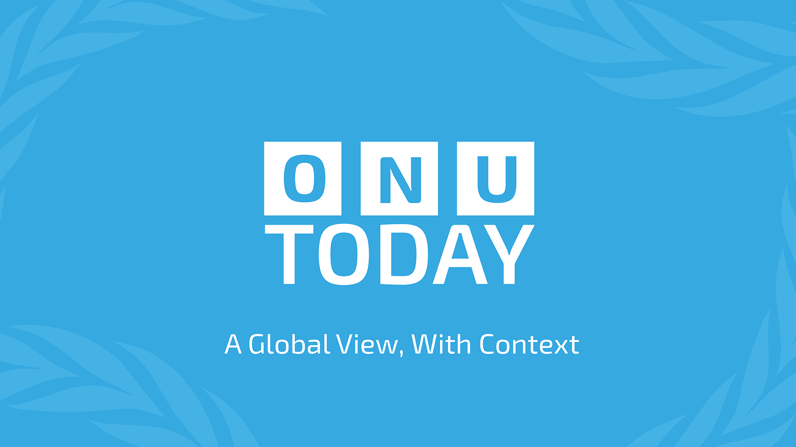
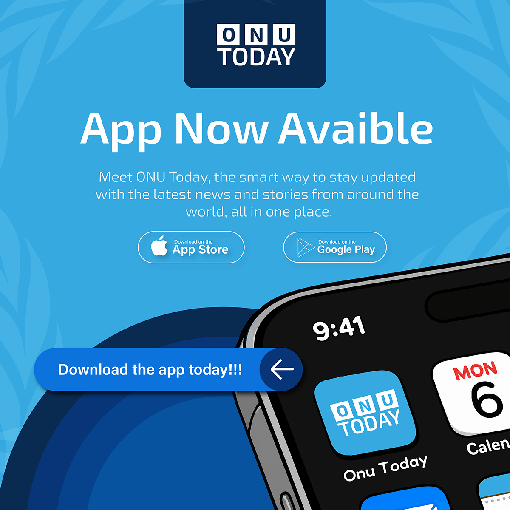
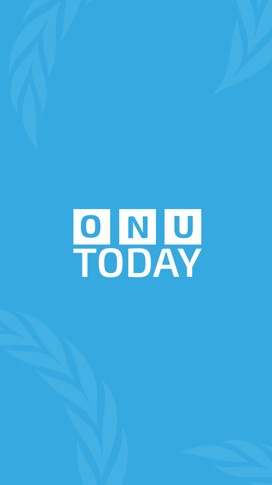
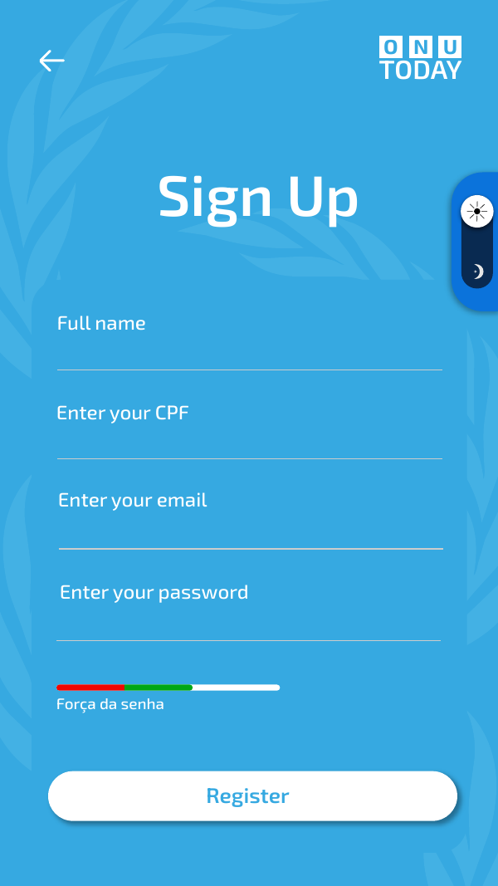
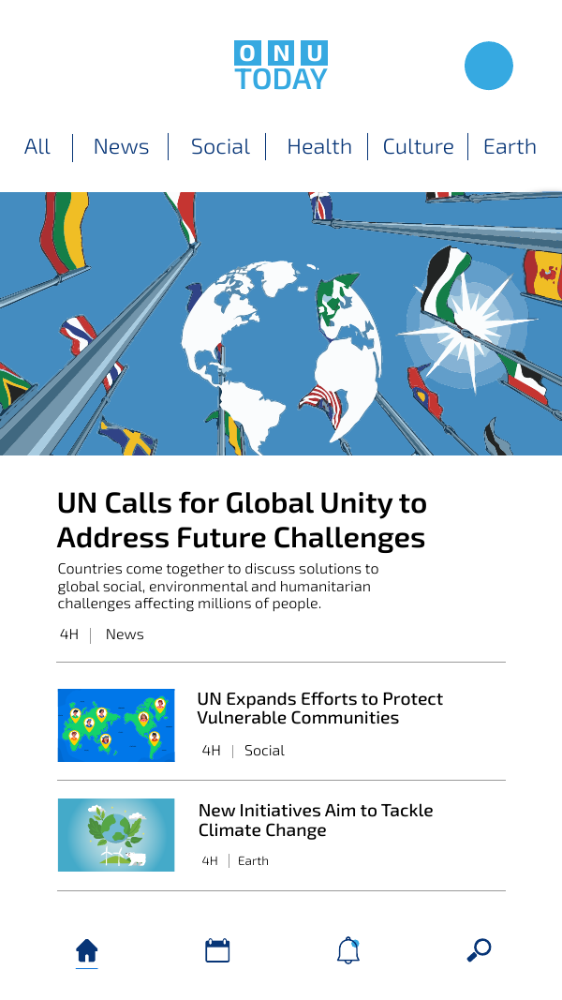

# ONUToday: identidade visual e mockup de app

Trabalho da prova de **Design de Mídia Digital** da Go Skills 2026, na Índia, em que conquistei a **medalha de ouro**.

ONUToday é um veículo de notícias fictício da ONU, com o lema *A Global View, With Context*.

## Identidade visual

## Mockup do app (mobile)
  

O app tem login, cadastro com indicador de força da senha, alternância entre tema claro e escuro e uma tela inicial com notícias separadas por categoria.

📄 [Ver a apresentação do projeto em PDF](ONUToday-apresentacao.pdf)

## Decisões de design
- **Conceito:** plataforma global de comunicação que contextualiza notícias e iniciativas humanitárias. A interface elimina o ruído visual e prioriza leitura rápida e acessibilidade para um público internacional.
- **Cores:** o azul institucional (azul da ONU) aparece nas telas iniciais e nos destaques, transmitindo confiança, paz, diplomacia e autoridade global. Branco e tons neutros garantem contraste em botões, campos e áreas de leitura, para uma navegação sem cansaço visual.
- **Logo:** a sigla ONU fica em três blocos sólidos, ideia de transparência e estrutura institucional. O peso forte de "TODAY" mantém a leitura imediata até em telas pequenas, e a fonte sem serifa moderna passa agilidade e neutralidade jornalística.
- **Tipografia:** sans-serif geométrica e limpa, combinando com a marca e o slogan *A Global View, With Context*. A hierarquia separa títulos em negrito e maiúsculas, slogans estilizados e texto corrido.
- **Usabilidade:** fluxo sem atrito, com login, cadastro e tutorial de boas-vindas em poucos passos e um indicador de força da senha.
- **Interface:** minimalista e baseada em cards, com imagens vetoriais, marcadores de tempo e tags coloridas por categoria. Marcas d'água suaves, que lembram os ramos de oliveira do símbolo da ONU, reforçam a identidade sem distrair.
- **Tela inicial:** depois do login, o leitor precisa ver rápido as notícias mais relevantes, sem navegar por muitos menus. A home resolve isso com um filtro horizontal de categorias (All, News, Social, Health, Culture, Earth) e uma lista organizada de notícias.

## Ferramenta
Adobe Illustrator
